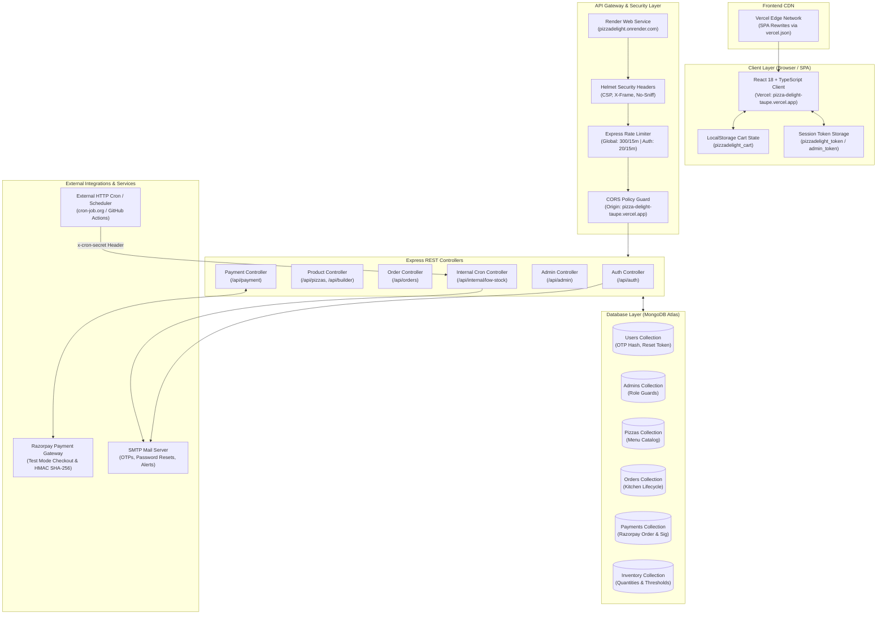
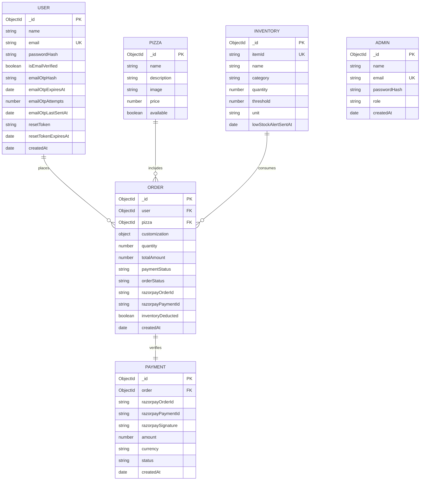

# PizzaDelight — Full-Stack Pizza Delivery & Inventory Management Platform

[](https://nodejs.org/)
[](https://react.dev/)
[](https://www.typescriptlang.org/)
[](https://expressjs.com/)
[](https://www.mongodb.com/)
[](https://tailwindcss.com/)
[](https://nodejs.org/api/test.html)
[](https://opensource.org/licenses/MIT)

> **Oasis Infobyte Internship Project**  
> **Intern Name:** Rohit Mistry  
> **Assigned Track:** Web Development & Designing — Level 3  
> **Task Title:** Pizza Delivery Full-Stack Application  
> **Submission Repository:** `OIBSIP`  
> **Submission Directory Convention:** `OIBSIP/WebDev-L3-PizzaDelight/`  

---

## 📑 Table of Contents

1. [Project Title & Introduction](#1-project-title--introduction)
2. [Project Objectives](#2-project-objectives)
3. [Live Deployment & Project Access](#3-live-deployment--project-access)
4. [Complete Feature Documentation](#4-complete-feature-documentation)
   - [Customer-Facing Features](#41-customer-facing-features)
   - [Administrative Features](#42-administrative-features)
   - [Platform & Security Features](#43-platform--security-features)
5. [Technology Stack](#5-technology-stack)
6. [System Architecture](#6-system-architecture)
7. [End-to-End Workflow Explanations](#7-end-to-end-workflow-explanations)
   - [Customer Ordering & Checkout Workflow](#71-customer-ordering--checkout-workflow)
   - [Customer Registration & Email OTP Verification](#72-customer-registration--email-otp-verification)
   - [Password Reset Workflow](#73-password-reset-workflow)
   - [Payment Processing & Stock Deduction](#74-payment-processing--stock-deduction)
   - [Admin Kitchen Kanban & Stock Replenishment](#75-admin-kitchen-kanban--stock-replenishment)
   - [Low-Stock Monitoring & Alerting Workflow](#76-low-stock-monitoring--alerting-workflow)
8. [Project Directory Structure](#8-project-directory-structure)
9. [Prerequisites & Installation](#9-prerequisites--installation)
10. [Environment Variable Reference](#10-environment-variable-reference)
11. [Local Development Guide](#11-local-development-guide)
12. [Database & Data Models](#12-database--data-models)
13. [API Documentation Reference](#13-api-documentation-reference)
14. [Authentication, Authorization & Security](#14-authentication-authorization--security)
15. [Payment Integration (Razorpay Test Mode)](#15-payment-integration-razorpay-test-mode)
16. [Email & Notification Functionality](#16-email--notification-functionality)
17. [Testing & Quality Assurance](#17-testing--quality-assurance)
18. [Production Deployment Guide](#18-production-deployment-guide)
19. [Troubleshooting Guide](#19-troubleshooting-guide)
20. [Limitations & Future Roadmap](#20-limitations--future-roadmap)
21. [Oasis Infobyte Internship Submission Compliance](#21-oasis-infobyte-internship-submission-compliance)
22. [Attribution, Licensing & Contact](#22-attribution-licensing--contact)

---

## 1. Project Title & Introduction

### What is PizzaDelight?
**PizzaDelight** is a production-grade, full-stack food ordering and real-time inventory management application engineered on the MERN stack (MongoDB, Express.js, React, Node.js) with TypeScript and Tailwind CSS. The platform delivers an end-to-end culinary commerce experience: customers can explore a curated pizza menu, design bespoke pizzas from scratch through an interactive builder with live ingredient pricing, manage persistent carts, verify their accounts using 6-digit email OTPs, and complete transactions through Razorpay Test Mode checkout. On the operations side, store managers and kitchen staff utilize a protected administration dashboard to track order lifecycles through kitchen stages, monitor live ingredient stocks, customize replenishment thresholds, and trigger automated low-stock notifications.

### The Problem it Solves
Standard food delivery mockups frequently present static web interfaces with hardcoded items and mock carts, lacking critical operational requirements such as server-authoritative pricing, stock-aware order acceptance, cryptographic payment verification, account recovery, and kitchen lifecycle tracking. 

PizzaDelight bridges this gap by implementing a cohesive, closed-loop commerce system:
- **E-Commerce Friction**: Customers face opaque pricing and confusing customization interfaces. PizzaDelight provides an intuitive visual builder that updates subtotals and 5% GST in real time.
- **Stock Depletion & Kitchen Inefficiency**: Kitchens accept orders for ingredients that have run out. PizzaDelight performs pre-flight inventory checks before payment order creation and executes atomic stock deductions upon verified checkout completion.
- **Account Security & Payment Fraud**: Client-side total tampering and credential abuse are prevented through server-calculated authoritative pricing, timing-safe HMAC SHA-256 payment signature verification, CSPRNG-generated email OTPs, and strict role-based access control.

### Target Audience & Users
1. **Registered Customers**: Browse menu items, customize crusts, gourmet sauces, cheeses, and toppings, manage persistent shopping carts, track active orders, and view order receipts.
2. **Kitchen & Store Administrators**: Review incoming orders, progress orders through standardized kitchen stages (`ORDER_RECEIVED` &rarr; `IN_KITCHEN` &rarr; `SENT_TO_DELIVERY`), monitor real-time ingredient levels, adjust low-stock thresholds, restock ingredients, and execute inventory audit checks.

### Why Full-Stack Architecture is Essential
PizzaDelight cannot function as a static client application because it requires:
- **Stateful Data Persistence**: Customer accounts, order histories, catalog configurations, and live ingredient levels stored in a distributed MongoDB database.
- **Authoritative Business Logic**: Calculating taxes, verifying item costs, preventing client price modification, and enforcing maximum order limits on the backend.
- **Cryptographic Security**: Generating and validating secure hashes for passwords (bcrypt 12 rounds), OTPs (SHA-256), and Razorpay webhook/payment signatures (`crypto.timingSafeEqual`).
- **Asynchronous Services**: Integrating third-party payment gateways (Razorpay), transactional email dispatchers (Nodemailer/SMTP), and scheduled cron jobs.

---

## 2. Project Objectives

| Category | Objective | Implementation Status | Verified Details |
| :--- | :--- | :--- | :--- |
| **Catalog & Builder** | Allow users to browse catalog pizzas and build custom pizzas with step-by-step ingredient selection | **Implemented & Verified** | Live catalog, custom builder with 5 crusts, 4 sauces, 4 cheeses, and 8 vegetable toppings with pricing enforcement |
| **Cart & Pricing** | Manage cart items, compute subtotal, 5% GST, free delivery, and enforce authoritative server totals | **Implemented & Verified** | Client-side reactive totals synchronized with backend `calculateOrderPricing` |
| **Authentication** | Provide registration, 6-digit email OTP verification, password hashing, and login sessions | **Implemented & Verified** | JWT session tokens, 10-minute OTP expiration, 60s resend cooldown, anti-enumeration security |
| **Account Recovery** | Secure password reset via time-limited email reset links | **Implemented & Verified** | Cryptographic token generation, SHA-256 hashed storage, 30-minute expiry |
| **Payment Flow** | Seamless checkout modal supporting UPI, Card, Netbanking, and Wallets with cryptographic verification | **Implemented & Verified** | Razorpay Test Mode checkout, server-authoritative order creation, HMAC SHA-256 signature verification |
| **Inventory Control** | Real-time stock decrement upon order confirmation with rollback on failure | **Implemented & Verified** | Atomic MongoDB updates (`$inc: -qty`) with rollback safeguarding ingredient quantities |
| **Admin Operations** | Dedicated dashboard for kitchen order progression and ingredient replenishment | **Implemented & Verified** | Admin JWT guards, Kanban status updater (`ORDER_RECEIVED` &rarr; `IN_KITCHEN` &rarr; `SENT_TO_DELIVERY`), inline stock & threshold editor |
| **Low-Stock Alerting** | Automated low-stock detection, alert deduplication, and email dispatch to store managers | **Implemented & Verified** | CLI check script (`npm run check-low-stock`) and protected HTTP cron endpoint (`POST /api/internal/low-stock`) |
| **Cart Clearing** | Automatic cart cleanup upon confirmed payment | **Implemented & Verified** | `localStorage`, `sessionStorage`, and React cart state cleared upon payment confirmation |

---

## 3. Live Deployment & Project Access

| Resource | Target / Platform | Verified Public URL | Status & Verified Details |
| :--- | :--- | :--- | :--- |
| **Customer Frontend** | Vercel (Edge SPA) | [https://pizza-delight-taupe.vercel.app/](https://pizza-delight-taupe.vercel.app/) | **Live & Verified** (HTTP 200, Single Page Application with client routing via `vercel.json`) |
| **Backend API Base** | Render (Web Service) | [https://pizzadelight.onrender.com](https://pizzadelight.onrender.com) | **Live & Verified** (Node.js 22 Alpine runtime, CORS bound to Vercel domain) |
| **Backend Health Check** | Render API Route | [https://pizzadelight.onrender.com/api/health](https://pizzadelight.onrender.com/api/health) | **Live & Verified** (Returns HTTP 200: `{"success":true,"message":"API is running","database":"connected",...}`) |
| **Source Repository** | GitHub (Git VCS) | [https://github.com/rohitmistry2005-afk/OIBSIP](https://github.com/rohitmistry2005-afk/OIBSIP) | **Live & Verified** (Target submission repo on branch `main`) |
| **Project Submission Path**| GitHub Subdirectory | `OIBSIP/WebDev-L3-PizzaDelight/` | **Verified Workspace Root** (Standardized internship project folder convention) |
| **Demonstration Video** | Local Media / Root | `PizzaDelight_Demo_Rohit_Mistry.mp4` | **Verified in Repository Root** (4.5 MB MP4 screen recording demonstrating all workflows) |

> [!NOTE]
> **Render Free Tier Spin-Up Behavior**: The backend API is hosted on Render's free tier. If no requests have been received for 15 minutes, the container spins down into a sleeping state. The first incoming request will experience a cold-start delay of approximately 45 to 60 seconds while the container initializes and connects to MongoDB Atlas. Subsequent requests respond with sub-second latency.

---

## 4. Complete Feature Documentation

### 4.1 Customer-Facing Features

#### A. Interactive Pizza Catalog & Details View
- **Curated Menu Exploration**: Customers can view an array of artisanal pizzas (Margherita, Pepperoni Feast, Veggie Supreme, BBQ Paneer Delight, etc.) with real-time pricing, ingredient breakdown, and high-resolution visuals.
- **Detailed Pizza Inspection**: Dedicated pizza details page displays nutritional notes, crust style, flavor profiles, and allows direct addition to cart with customizable quantities (1 to 20 units).
- **Responsive Navigation**: Fluid filter tags and category chips enable effortless browsing between Classic, Gourmet, Vegetarian, and Custom categories.

#### B. Bespoke Pizza Builder
- **Step-by-Step Customization**: Interactive 4-step wizard:
  1. **Crust Selection**: Hand Tossed (`+₹199`), Cheese Burst (`+₹249`), Thin Crust (`+₹189`), Pan Pizza (`+₹219`), Whole Wheat (`+₹209`).
  2. **Gourmet Sauce Selection**: Classic Herb Marinara (`+₹49`), Spicy Arrabiata (`+₹59`), Creamy Garlic White Sauce (`+₹69`), Smoky BBQ Sauce (`+₹59`).
  3. **Artisan Cheese Selection**: Traditional Mozzarella (`+₹89`), Smoked Cheddar (`+₹99`), Four-Cheese Blend (`+₹129`), Low-Fat Ricotta (`+₹79`).
  4. **Fresh Vegetable Toppings**: Crisp Bell Peppers, Red Onions, Button Mushrooms, Black Olives, Sweet Corn, Fresh Jalapeños, Baby Spinach, Cherry Tomatoes (`+₹39` each, up to 6 selections).
- **Real-Time Price & Nutrition Feedback**: Dynamic pricing calculation recalculates the unit price instantaneously as toppings are toggled.
- **Pre-Flight Stock Enforcement**: If any required ingredient is exhausted in inventory, the builder warns the customer and prevents checkout.

#### C. Shopping Basket & Price Calculation
- **Cart Management**: Add pizzas, increase/decrease quantities, or remove items with instant state updates.
- **Persistent State**: Cart contents are synchronized to browser `localStorage` under `pizzadelight_cart`, ensuring items remain intact across page reloads.
- **Authoritative Price Breakdown**:
  $$\text{Subtotal} = \sum (\text{Unit Price} \times \text{Quantity})$$
  $$\text{Taxes (5\% GST)} = \text{round}(\text{Subtotal} \times 0.05)$$
  $$\text{Delivery Fee} = ₹0\quad\text{(Promotional Free Delivery)}$$
  $$\text{Total Amount} = \text{Subtotal} + \text{Taxes}$$

#### D. Authentication, Registration & Email OTP Verification
- **User Registration**: Customers register with name, email, and password (enforcing minimum 8 characters).
- **6-Digit Cryptographic Email OTP**:
  - Outgoing OTP generated using Node.js CSPRNG (`crypto.randomInt(0, 1000000)`).
  - Stored in MongoDB strictly as a SHA-256 hash (plaintext OTP is never saved).
  - Valid for exactly 10 minutes.
  - Server-enforced 60-second cooldown between resend requests.
  - Maximum attempt ceiling of 5 invalid submissions before OTP invalidation.
- **Anti-Account Enumeration**: Registration and OTP requests for existing or non-existent accounts return identical generic response codes to prevent username scraping.
- **Session Tokens**: JWT issued upon login with 24-hour expiration (`1d`), stored in `localStorage` under `pizzadelight_token`.

#### E. Password Reset Workflow
- **Forgot Password Portal**: Customers request a password reset by providing their registered email address.
- **Cryptographic Reset Tokens**: Secure 32-byte hex token generated via `crypto.randomBytes(32)` and stored as a SHA-256 hash with a 30-minute expiration timestamp.
- **Token Invalidation**: Consuming a reset token immediately sets `resetToken` and `resetTokenExpiresAt` to `null` to prevent replay attacks.

#### F. Checkout, Payment & Order Tracking
- **Unified Checkout Stepper**: 3-stage visual checkout stepper (`Cart` &rarr; `Order Summary` &rarr; `Payment`).
- **Payment Method Support**: Razorpay checkout with seamless pre-selection for UPI (`upi`), Credit/Debit Cards (`card`), Netbanking (`netbanking`), and Digital Wallets (`wallet`).
- **Cart Cleared Post-Payment**: Upon receipt of verified payment signature from the backend, the application clears browser `localStorage`, `sessionStorage`, and React state before redirecting to `/order-confirmed`.
- **Live Order Tracking**: Dedicated order receipt and tracking view (`/order-details/:id` or `/profile`) displaying the order creation timestamp, itemized ingredients, payment status (`SUCCESS`), and live kitchen status (`ORDER_RECEIVED`, `IN_KITCHEN`, `SENT_TO_DELIVERY`).

---

### 4.2 Administrative Features

#### A. Dedicated Admin Authentication
- **Isolated Portal**: Separate admin entry point (`/admin/login`) requiring dedicated administrator credentials.
- **Role Isolation**: Admin tokens contain `{ role: 'admin', type: 'admin' }`. Customers cannot access admin routes, and admins cannot submit customer orders.

#### B. Kitchen Lifecycle & Order Management Dashboard
- **Kanban Overview**: Kitchen staff view all orders in descending chronological order, populated with customer details, selected pizza base, sauces, and toppings.
- **State Progression Engine**: Orders move through a strict state machine:
  $$\text{ORDER\_RECEIVED} \longrightarrow \text{IN\_KITCHEN} \longrightarrow \text{SENT\_TO\_DELIVERY}$$
- **State Validation**: Arbitrary status jumps or reversals are rejected by the backend with HTTP 400 (`Invalid status transition`).

#### C. Real-Time Ingredient Inventory & Thresholds
- **Catalogued Ingredients**: Tracks stock for all operational items across categories: `base`, `sauce`, `cheese`, and `vegetable`.
- **Customizable Alert Thresholds**: Every ingredient defaults to a threshold of 20 units, modifiable dynamically through the admin interface (`PATCH /api/admin/inventory/:id`).
- **Stock Depletion & Auto-Deduction**: Whenever a customer order is verified, required quantities for the base, sauce, cheese, and all selected toppings are atomically deducted.
- **Restocking & Alert State Recovery**: When an administrator restocks an ingredient such that $\text{quantity} \ge \text{threshold}$, the system resets `lowStockAlertSentAt = null`. This guarantees that if stock falls below the threshold in the future, a fresh notification will be dispatched.

---

### 4.3 Platform & Security Features

- **Authoritative Price Validation**: Server validates every customization option against `product-options.js` and independently computes the total. Client-supplied amounts are checked against server totals ($|\text{clientAmount} - \text{serverAmount}| \le 0.01$); mismatches are rejected with HTTP 400.
- **Timing-Safe HMAC Verification**: Razorpay payment signatures are validated using timing-safe comparisons (`crypto.timingSafeEqual`) to prevent timing side-channel attacks.
- **Rate Limiting**:
  - Global rate limiter: 300 requests per 15-minute window per IP.
  - Auth rate limiter: 20 requests per 15-minute window for sensitive endpoints (`/login`, `/register`, `/verify-otp`, `/forgot-password`).
- **HTTP Security Headers**: Powered by Helmet to enforce `Content-Security-Policy`, `X-Content-Type-Options: nosniff`, `X-Frame-Options: SAMEORIGIN`, and strict referrer policies.
- **Protected Cron Scheduler**: Internal inventory inspection endpoint (`POST /api/internal/low-stock`) requires a private `x-cron-secret` header validated via timing-safe buffer comparison.
- **Console Fallback for Local Development**: When SMTP credentials are empty during development, emails (OTPs, password reset links, low-stock alerts) are safely printed to the server terminal with sensitive credentials masked.

---

## 5. Technology Stack

| Layer / Technology | Exact Version | Purpose in PizzaDelight | Component |
| :--- | :--- | :--- | :--- |
| **React** | `v18.3.1` | Declarative component UI rendering and reactive application state | Frontend (`frontend/src/`) |
| **TypeScript** | `v5.5.3` | Static typing, interface definitions for API responses and models | Frontend (`tsconfig.app.json`) |
| **Vite** | `v5.4.2` | Fast HMR development server and optimized rollup production bundler | Frontend (`vite.config.ts`) |
| **Tailwind CSS** | `v3.4.1` | Utility-first responsive CSS styling with custom design tokens | Frontend (`tailwind.config.js`) |
| **Lucide React** | `v0.446.0` | Accessible SVG icon suite for pizza builder, payment, and kitchen controls | Frontend UI components |
| **Node.js** | `v20.x / v22.x` | High-performance asynchronous JavaScript server runtime | Backend runtime (`package.json`) |
| **Express.js** | `v5.1.0` | REST API routing, request middleware, and controller dispatch | Backend (`backend/src/app.js`) |
| **MongoDB Driver** | `v7.6.0` | Low-level MongoDB database connectivity and connection pool management | Backend |
| **Mongoose** | `v8.19.0` | Schema definition, model validation, and indexing for MongoDB Atlas | Backend (`backend/src/models/`) |
| **Bcryptjs** | `v3.0.2` | Salted 12-round password hashing for customer and admin credentials | Backend (`auth.service.js`) |
| **JSONWebToken** | `v9.0.2` | Cryptographic JWT signing and payload verification for session tokens | Backend (`jwt.util.js`) |
| **Razorpay SDK** | `v2.9.6` | Payment gateway order generation and customer checkout session creation | Backend (`payment.service.js`) |
| **Nodemailer** | `v7.0.6` | SMTP transactional email client for OTPs, password resets, and stock alerts | Backend (`email.service.js`) |
| **Helmet** | `v8.1.0` | HTTP security headers protecting against XSS, clickjacking, and sniffing | Backend (`security.middleware.js`) |
| **Express Rate Limit**| `v8.1.0` | Sliding-window IP rate limiter safeguarding auth and API endpoints | Backend (`security.middleware.js`) |
| **Node Test Runner** | Built-in | Native unit and integration test framework (`node --test`) | Backend (`backend/test/`) |
| **Vercel** | Cloud Platform | Single-Page Application CDN hosting with SPA route rewrites | Frontend Hosting (`vercel.json`) |
| **Render** | Cloud Platform | Containerized Node.js Web Service hosting with HTTPS termination | Backend Hosting (`Dockerfile`) |
| **MongoDB Atlas** | Managed Cloud DB| Resilient cloud database with automated replication and IP whitelisting | Data Persistence |

---

## 6. System Architecture

### Architectural Overview
PizzaDelight follows a decoupled, three-tier microservice-ready architecture. The React Single Page Application (SPA) runs on Vercel's Edge Network, communicating asynchronously with the Node.js/Express REST API hosted on Render. Persistent storage is managed on a multi-replica MongoDB Atlas cluster. External integrations handle payment processing (Razorpay Test Mode), transactional emails (Nodemailer/SMTP), and scheduled stock audits (External HTTP Cron).



---

## 7. End-to-End Workflow Explanations

### 7.1 Customer Ordering & Checkout Workflow

```mermaid
sequenceDiagram
    autonumber
    actor Customer
    participant UI as React Frontend (Payment.tsx)
    participant API as Express API (/api/orders)
    participant PayAPI as Express API (/api/payment)
    participant DB as MongoDB Atlas
    participant RZP as Razorpay Gateway

    Customer->>UI: Selects base, sauce, cheese & vegetables
    UI->>UI: Computes subtotal + 5% GST in local state
    Customer->>UI: Clicks "Proceed to Payment"
    UI->>API: POST /api/orders (customization, quantity)
    API->>API: Server validates items against catalog & computes authoritative price
    API->>DB: Persist Order (status: ORDER_RECEIVED, paymentStatus: PENDING)
    API-->>UI: Returns created order object & orderId
    UI->>PayAPI: POST /api/payment/create-order (orderId, clientAmount)
    PayAPI->>PayAPI: Verifies clientAmount matches order.totalAmount
    PayAPI->>DB: Checks inventory levels for all required ingredients
    PayAPI->>RZP: client.orders.create({ amount: amountInPaise, currency: 'INR' })
    RZP-->>PayAPI: Returns Razorpay order_id
    PayAPI->>DB: Updates Order with razorpayOrderId; creates Payment (CREATED)
    PayAPI-->>UI: Returns { keyId, razorpayOrderId, amount }
    UI->>RZP: Opens Razorpay Checkout Modal (preselected method)
    Customer->>RZP: Completes payment transaction in Test Mode
    RZP-->>UI: Returns { razorpay_payment_id, razorpay_order_id, razorpay_signature }
    UI->>PayAPI: POST /api/payment/verify (signature, IDs)
    PayAPI->>PayAPI: crypto.timingSafeEqual(computedHMAC, razorpay_signature)
    PayAPI->>DB: Atomic inventory decrement ($inc: -quantity)
    PayAPI->>DB: Updates Order (paymentStatus: SUCCESS, inventoryDeducted: true)
    PayAPI-->>UI: Returns { success: true }
    UI->>UI: Clears cart from localStorage, sessionStorage & state
    UI-->>Customer: Redirects to /order-confirmed?orderId=...
```

### 7.2 Customer Registration & Email OTP Verification
1. **Registration Submission**: Customer submits name, email, and password on `/register`.
2. **Backend Validation**: `POST /api/auth/register` validates field lengths, checks for existing email, and hashes password using `bcryptjs` with 12 salt rounds.
3. **CSPRNG OTP Generation**: The server generates a 6-digit numeric string using `crypto.randomInt(0, 1000000)`.
4. **Hashed Persistence**: The SHA-256 digest is calculated (`crypto.createHash('sha256').update(otp).digest('hex')`) and saved to `user.emailOtpHash`. Expiration is set to $T_{\text{now}} + 10\text{ minutes}$.
5. **Dispatch**: Nodemailer dispatches an email displaying the bold 6-digit OTP. (In local development without SMTP credentials, the dispatch is simulated and logged to the server console).
6. **Verification Submission**: Customer inputs OTP on `/verify-otp`.
7. **Timing-Safe Evaluation**: `POST /api/auth/verify-otp` hashes the submitted code and performs a timing-safe equality check against `user.emailOtpHash`.
8. **Activation**: Upon match, `user.isEmailVerified` is set to `true`, and OTP fields are cleared. Customer can now log in securely.

### 7.3 Password Reset Workflow
1. **Reset Request**: Customer inputs registered email on `/forgot-password`.
2. **Anti-Enumeration Guard**: Whether the email exists or not, the server responds with a uniform 200 message: `"If an account with that email exists, a password reset link has been sent."`
3. **Token Creation**: For valid accounts, `crypto.randomBytes(32).toString('hex')` generates a unique token. The SHA-256 hash is saved to `user.resetToken` with a 30-minute expiry.
4. **Email Dispatch**: Reset link formatted as `${CLIENT_URL}/reset-password?token=${token}&email=${email}` is dispatched.
5. **Token Consumption**: On `/reset-password`, the customer enters a new password ($ \ge 8$ characters).
6. **Re-Hashing & Invalidation**: `POST /api/auth/reset-password` validates the hash and expiry, updates `passwordHash` using 12 bcrypt rounds, and nullifies `resetToken` and `resetTokenExpiresAt`.

### 7.4 Payment Processing & Stock Deduction
1. **Authoritative Price Enforcement**: `createRazorpayOrderForUser` rejects any client amount deviating from the database order record ($> 0.01$).
2. **Pre-Flight Inventory Check**: Queries the `inventories` collection. If any required ingredient has $\text{quantity} < \text{order.quantity}$, checkout aborts immediately with HTTP 409 (`Insufficient stock`).
3. **Cryptographic Signature Verification**:
   $$\text{Generated Signature} = \text{HMAC-SHA256}(\text{razorpayOrderId} \parallel "|" \parallel \text{razorpayPaymentId}, \text{RAZORPAY\_KEY\_SECRET})$$
4. **Atomic Decrement & Rollback**: Each ingredient is updated using `findOneAndUpdate({ category, itemId, quantity: { $gte: quantity } }, { $inc: { quantity: -quantity } })`. If any update fails mid-sequence, all preceding decrements are rolled back by incrementing them back.
5. **State Finalization**: Order is marked `paymentStatus: 'SUCCESS'` and `inventoryDeducted: true`.

### 7.5 Admin Kitchen Kanban & Stock Replenishment
1. **Admin Login**: Admin logs in via `/admin/login` (`POST /api/admin/auth/login`), receiving an admin-scoped JWT.
2. **Order Inspection**: Admin navigates to `/admin/orders` to view incoming orders with complete customer details and customized toppings.
3. **Status Progression**: Clicking "Start Preparation" sends `PATCH /api/admin/orders/:id/status` with `{ status: 'IN_KITCHEN' }`. Once cooked, clicking "Dispatch" advances status to `'SENT_TO_DELIVERY'`.
4. **Stock Control**: Admin navigates to `/admin/inventory` (`GET /api/admin/inventory`), viewing current quantities, thresholds, and low-stock warning badges.
5. **Threshold & Quantity Modification**: Admin updates values inline (`PATCH /api/admin/inventory/:id`). If an item is replenished above its threshold, the system resets `lowStockAlertSentAt = null`, arming it for future alerts.

### 7.6 Low-Stock Monitoring & Alerting Workflow
1. **Audit Trigger**: Executed either manually via CLI (`npm run check-low-stock`) or via scheduled HTTP request (`POST /api/internal/low-stock`).
2. **Secret Header Validation**: HTTP triggers must pass the header `x-cron-secret: <CRON_SECRET>`. The server validates this using `crypto.timingSafeEqual`.
3. **Eligibility Filter**: Queries all inventory items where $\text{quantity} < \text{threshold}$ AND $\text{lowStockAlertSentAt} == \text{null}$.
4. **Deduplication & Dispatch**: Sends an HTML alert table to `ADMIN_EMAIL` detailing item name, category, current count, and threshold. Sets `lowStockAlertSentAt = new Date()`, preventing redundant emails until the item is restocked.

---

## 8. Project Directory Structure

```
WebDev-L3-PizzaDelight/
│
├── .gitignore                      # Git exclusion rules for secrets, builds, media, and logs
├── README.md                       # Primary comprehensive project documentation (this file)
├── PizzaDelight_Demo_Rohit_Mistry.mp4 # Video demonstration for internship evaluation (4.5 MB)
│
├── backend/                        # Node.js + Express.js REST API service
│   ├── Dockerfile                  # Multi-stage production container build (Node.js 22 Alpine)
│   ├── package.json                # Dependencies, test scripts, and operational scripts
│   ├── .env.example                # Safe environment variable configuration template
│   │
│   ├── src/
│   │   ├── app.js                  # Express application setup, security middleware, and route mounting
│   │   ├── server.js               # Server initialization, config validation, and MongoDB connect
│   │   │
│   │   ├── config/
│   │   │   ├── db.js               # Mongoose connection handler with IPv6 fallback & retry logic
│   │   │   ├── env.js              # Environment variable loading, validation, and sender formatting
│   │   │   └── product-options.js  # Authoritative catalog options (bases, sauces, cheeses, toppings)
│   │   │
│   │   ├── controllers/            # Request handlers and response formatters
│   │   │   ├── admin.controller.js # Order inspection, status updates, inventory management
│   │   │   ├── auth.controller.js  # Registration, login, OTP verification, password reset
│   │   │   ├── health.controller.js# API and database connectivity status check (/api/health)
│   │   │   ├── internal.controller.js # Protected low-stock check trigger
│   │   │   ├── order.controller.js # Order creation, user order history, and single order details
│   │   │   ├── payment.controller.js # Razorpay order creation and HMAC signature verification
│   │   │   └── product.controller.js # Catalog listing and builder option retrieval
│   │   │
│   │   ├── jobs/
│   │   │   └── low-stock.job.js    # Low-stock scanning routine interface
│   │   │
│   │   ├── middleware/             # Route-level security and interceptor functions
│   │   │   ├── auth.middleware.js  # Customer and admin JWT bearer authentication guards
│   │   │   ├── cron-auth.middleware.js # Timing-safe x-cron-secret header verification
│   │   │   ├── error-handler.js    # Global JSON error response handler
│   │   │   ├── not-found.js        # 404 handler for unrecognized route paths
│   │   │   └── security.middleware.js # Helmet headers, rate limiters, and production config check
│   │   │
│   │   ├── models/                 # Mongoose schemas and data entity definitions
│   │   │   ├── admin.model.js      # Administrator credentials and role definition
│   │   │   ├── inventory.model.js  # Ingredient stocks, units, alert thresholds, and alert timestamps
│   │   │   ├── order.model.js      # Orders, embedded customizations, quantities, and status enums
│   │   │   ├── payment.model.js    # Payment records, Razorpay order/payment IDs, and status
│   │   │   ├── pizza.model.js      # Standard catalog pizzas, descriptions, images, and prices
│   │   │   └── user.model.js       # Customer accounts, OTP hashes, expiration, and reset tokens
│   │   │
│   │   ├── routes/                 # Express route declarations
│   │   │   ├── admin.routes.js     # /api/admin (login, orders, inventory)
│   │   │   ├── auth.routes.js      # /api/auth (register, OTP, login, password reset)
│   │   │   ├── health.routes.js    # /api/health (service health probe)
│   │   │   ├── internal.routes.js  # /api/internal/low-stock (protected cron route)
│   │   │   ├── order.routes.js     # /api/orders (order creation and retrieval)
│   │   │   ├── payment.routes.js   # /api/payment (create-order and signature verify)
│   │   │   └── product.routes.js   # /api/pizzas and /api/builder/options
│   │   │
│   │   ├── services/               # Reusable business logic layers
│   │   │   ├── admin.service.js    # Order lifecycle transitions and stock replenishment
│   │   │   ├── email.service.js    # Nodemailer transporter and HTML email templates
│   │   │   ├── notification.service.js # Low-stock audit logic and alert deduplication
│   │   │   ├── order.service.js    # Authoritative price calculation and order validation
│   │   │   ├── otp.service.js      # CSPRNG OTP generation, SHA-256 hashing, timing-safe verification
│   │   │   └── payment.service.js  # Razorpay client integration, stock deduction & rollback
│   │   │
│   │   └── utils/
│   │       ├── crypto.util.js      # Random token generator for password reset
│   │       └── jwt.util.js         # JWT signing and verification helpers
│   │
│   ├── scripts/                    # Database initialization and diagnostic utilities
│   │   ├── check-low-stock.js      # Manual CLI low-stock scan and alert trigger
│   │   ├── create-admin.js         # CLI script to bootstrap an administrator account
│   │   ├── seed-inventory.js       # Seeds baseline ingredient stocks (bases, sauces, cheeses, vegetables)
│   │   ├── seed-pizzas.js          # Seeds standard menu pizzas into MongoDB
│   │   └── smoke-test.js           # Lightweight curl-like health endpoint smoke test
│   │
│   └── test/                       # Unit and integration automated test suite
│       └── unit/                   # 133 tests covering auth, orders, payments, OTP, and inventory
│
└── frontend/                       # Vite + React + TypeScript Single Page Application
    ├── package.json                # Dependencies, build scripts, linter, and typechecker
    ├── tsconfig.json               # Root TypeScript configuration
    ├── tsconfig.app.json           # Application-specific compiler settings
    ├── vite.config.ts              # Vite configuration with React plugin
    ├── tailwind.config.js          # Tailwind CSS design system extensions
    ├── postcss.config.js           # PostCSS plugins (Tailwind, Autoprefixer)
    ├── vercel.json                 # Vercel deployment routing rules (SPA fallback rewrites)
    ├── .env.example                # Safe environment variable configuration template
    │
    ├── public/                     # Static assets, favicon, pizza icons
    └── src/
        ├── App.tsx                 # Root router, global navigation, and modal state management
        ├── main.tsx                # React DOM entry point
        ├── index.css               # Global typography, color tokens, and custom utility classes
        ├── CustomerLayout.tsx      # Shared customer shell with header, banner, and navigation
        ├── CustomerDashboard.tsx   # Pizza catalog display and category filtering
        ├── PizzaDetails.tsx        # In-depth pizza inspection and direct cart addition
        ├── Payment.tsx             # 3-step checkout interface and Razorpay modal integration
        ├── OrderDetails.tsx        # Itemized order receipt and live kitchen status tracker
        ├── VerifyOtp.tsx           # 6-digit email OTP verification form with resend timer
        ├── EmailVerification.tsx   # Legacy email verification landing page
        ├── ForgotPassword.tsx      # Password reset request form
        ├── ResetPassword.tsx       # Token-based new password submission form
        ├── Profile.tsx             # Customer account summary and previous order history
        ├── AdminLogin.tsx          # Dedicated admin authentication interface
        ├── AdminOrdersList.tsx     # Kitchen Kanban dashboard for order status updates
        ├── AdminOrderDetails.tsx   # Detailed inspection of specific customer orders
        ├── AdminInventory.tsx      # Real-time ingredient stock control & restock panel
        ├── AboutPage.tsx           # Brand story, freshness promise, and mission view
        │
        └── services/               # Modular API client services
            ├── adminApi.ts         # Admin order and inventory API calls
            ├── adminAuth.ts        # Admin authentication helper methods
            ├── api.ts              # Core fetch wrapper with JWT token interceptors
            ├── auth.ts             # Auth state helpers and session management
            ├── authApi.ts          # Customer registration, login, OTP, and reset API calls
            ├── orderApi.ts         # Order creation and retrieval API calls
            ├── payment.ts          # Razorpay checkout modal controller and price calculator
            ├── paymentApi.ts       # Payment order creation and verification API calls
            ├── productApi.ts       # Catalog and builder options API calls
            └── userApi.ts          # User profile API endpoints
```

---

## 9. Prerequisites & Installation

### Required Software & Supported Runtimes
- **Node.js**: `v18.0.0` or higher (`v20.x` or `v22.x` recommended)
- **npm**: `v9.0.0` or higher
- **MongoDB**: Local MongoDB community server (`v6.0+`) or a MongoDB Atlas free-tier M0 cluster
- **Git**: `v2.30+` for version control management

### Step-by-Step Installation

#### 1. Clone the Repository
```bash
git clone https://github.com/rohitmistry2005-afk/OIBSIP.git
cd OIBSIP/WebDev-L3-PizzaDelight
```
*(If working directly inside the cloned workspace, verify you are in the `WebDev-L3-PizzaDelight` project root).*

#### 2. Configure Backend Environment
```bash
# Windows PowerShell
Copy-Item backend\.env.example backend\.env

# macOS / Linux
cp backend/.env.example backend/.env
```
Open `backend/.env` in your text editor and adjust values (see [Environment Variable Reference](#10-environment-variable-reference) below).

#### 3. Install Backend Dependencies & Seed Database
```bash
cd backend
npm install

# Seed catalog pizzas and initial ingredient inventory
npm run seed-pizzas
npm run seed-inventory

# Bootstrap an administrator account
npm run create-admin -- "Store Admin" admin@pizzadelight.com AdminPassword123!

cd ..
```

#### 4. Configure Frontend Environment
```bash
# Windows PowerShell
Copy-Item frontend\.env.example frontend\.env

# macOS / Linux
cp frontend/.env.example frontend/.env
```
Ensure `frontend/.env` points to your backend instance:
```env
VITE_API_URL=http://localhost:5000/api
VITE_RAZORPAY_KEY_ID=rzp_test_your_key_id
```

#### 5. Install Frontend Dependencies
```bash
cd frontend
npm install
cd ..
```

---

## 10. Environment Variable Reference

### Backend Configuration (`backend/.env`)

| Variable Name | Required | Description | Default / Example Value |
| :--- | :---: | :--- | :--- |
| `NODE_ENV` | Optional | Application runtime environment (`development`, `production`, `test`) | `development` |
| `PORT` | Optional | Port on which the Express HTTP server listens | `5000` |
| `MONGO_URI` | **Required** | MongoDB connection string (Local or MongoDB Atlas) | `mongodb://127.0.0.1:27017/pizza_delivery` |
| `JWT_SECRET` | **Required** | Private secret for signing JWTs ($\ge 32$ chars enforced in production) | `your_super_secret_jwt_key_at_least_32_characters_long` |
| `JWT_EXPIRES_IN` | Optional | Validity duration for customer and admin session tokens | `1d` |
| `CLIENT_URL` | **Required** | Allowed origin for Cross-Origin Resource Sharing (CORS) | `http://localhost:5173` |
| `SMTP_HOST` | Optional | SMTP mail server hostname (leave empty for console logging) | `smtp.gmail.com` |
| `SMTP_PORT` | Optional | SMTP mail server port (usually `587` for TLS or `465` for SSL) | `587` |
| `SMTP_USER` | Optional | SMTP username / sender account email | `your_email@gmail.com` |
| `SMTP_PASS` | Optional | SMTP password / Gmail App Password (16 characters) | `your_gmail_app_password` |
| `EMAIL_FROM` | Optional | Verified sender email address displayed in outgoing emails | `no-reply@pizzadelight.com` |
| `ADMIN_EMAIL` | Optional | Recipient address for automated low-stock inventory alerts | `admin@pizzadelight.com` |
| `RAZORPAY_KEY_ID` | **Required** | Public Razorpay API key identifier for Test Mode | `rzp_test_your_key_id` |
| `RAZORPAY_KEY_SECRET` | **Required** | Private Razorpay API secret used for HMAC SHA-256 signature checks | `your_razorpay_secret` |
| `RAZORPAY_CURRENCY` | Optional | Transaction currency code | `INR` |
| `CRON_SECRET` | **Required** | Shared secret required in `x-cron-secret` header for scheduled checks | `your_secure_cron_secret` |
| `AUTH_RATE_LIMIT` | Optional | Maximum auth requests allowed per 15-minute window | `100` |

### Frontend Configuration (`frontend/.env`)

| Variable Name | Required | Description | Default / Example Value |
| :--- | :---: | :--- | :--- |
| `VITE_API_URL` | **Required** | Fully qualified URL pointing to backend `/api` prefix | `http://localhost:5000/api` |
| `VITE_RAZORPAY_KEY_ID` | Optional | Fallback Razorpay Key ID (dynamically supplied by backend order endpoint) | `rzp_test_your_key_id` |

> [!WARNING]
> **Security Guardrails**:
> 1. Never commit `.env` files to GitHub. Both `backend/.env` and `frontend/.env` are strictly excluded in `.gitignore`.
> 2. `VITE_` variables are embedded into public client-side JavaScript bundles during build. **Never** place private secrets (`JWT_SECRET`, `RAZORPAY_KEY_SECRET`, `SMTP_PASS`, `CRON_SECRET`) in `frontend/.env`.

---

## 11. Local Development Guide

### Starting the Application as a Connected System

To run the complete application locally, open two terminal windows:

#### Terminal 1 — Start the Backend Server
```bash
cd backend
npm run dev
```
*Expected Console Output:*
```
[nodemon] starting `node src/server.js`
MongoDB connected successfully
API server running on http://localhost:5000
[razorpay] Configuration present: true | Key ID present: true | Secret present: true
```

#### Terminal 2 — Start the Frontend Client
```bash
cd frontend
npm run dev
```
*Expected Console Output:*
```
  VITE v5.4.2  ready in 280 ms

  ➜  Local:   http://localhost:5173/
  ➜  Network: use --host to expose
```

### Verifying System Health & Database Connectivity
1. **API Health**: Visit `http://localhost:5000/api/health` in your browser. You should receive:
   ```json
   {
     "success": true,
     "message": "API is running",
     "database": "connected",
     "timestamp": "2026-10-15T00:00:00.000Z"
   }
   ```
2. **Catalog Options**: Verify that product options load at `http://localhost:5000/api/builder/options`.
3. **Frontend UI**: Open `http://localhost:5173` to explore the catalog, build a pizza, and simulate ordering.

---

## 12. Database & Data Models

PizzaDelight uses **MongoDB Atlas** with structured **Mongoose** models:



### Entity Specifications
- **User (`User`)**: Stores customer credentials, verification flags, and security parameters. Sensitive data (`passwordHash`, `emailOtpHash`, `resetToken`) are indexed or hashed; plaintext tokens are never stored.
- **Admin (`Admin`)**: Dedicated collection for administrative personnel with role enforcement (`role: 'admin'`).
- **Pizza (`Pizza`)**: Represents standardized menu items with name, description, image asset path, price, and availability flag.
- **Inventory (`Inventory`)**: Tracks individual ingredients categorized into `base`, `sauce`, `cheese`, and `vegetable`. Maintains `quantity`, configurable `threshold` (default 20), and `lowStockAlertSentAt` for alert deduplication.
- **Order (`Order`)**: Captures customer order specifics, embedded customization snapshots (ensuring historical pricing integrity even if catalog prices change), quantity, total authoritative amount, payment status (`PENDING`, `PROCESSING`, `SUCCESS`, `FAILED`), and kitchen lifecycle status (`ORDER_RECEIVED`, `IN_KITCHEN`, `SENT_TO_DELIVERY`).
- **Payment (`Payment`)**: Audit ledger linking Razorpay transaction identifiers (`razorpayOrderId`, `razorpayPaymentId`, `razorpaySignature`) to internal orders.

---

## 13. API Documentation Reference

All endpoints are prefixed with `/api`. Protected routes require an `Authorization: Bearer <JWT>` header unless otherwise specified.

### 13.1 Health & Service Probes
| Method | Endpoint | Auth | Description | Response Status |
| :--- | :--- | :---: | :--- | :--- |
| `GET` | `/health` | Public | Returns service status and database connectivity | `200 OK` |

### 13.2 Customer Authentication & Account Recovery (`/api/auth`)
| Method | Endpoint | Auth | Description | Request Body Highlights |
| :--- | :--- | :---: | :--- | :--- |
| `POST` | `/auth/register` | Rate-Limited | Register new user & dispatch 6-digit OTP | `{ name, email, password }` |
| `POST` | `/auth/verify-otp` | Rate-Limited | Verify email via 6-digit OTP | `{ email, otp }` |
| `POST` | `/auth/resend-otp` | Rate-Limited | Request fresh OTP (60s cooldown) | `{ email }` |
| `POST` | `/auth/login` | Rate-Limited | Authenticate user & issue JWT | `{ email, password }` |
| `GET` | `/auth/me` | Customer JWT | Retrieve active user profile | None |
| `POST` | `/auth/logout` | Public | Terminate active user session | None |
| `POST` | `/auth/forgot-password`| Rate-Limited | Initiate password reset link | `{ email }` |
| `POST` | `/auth/reset-password` | Rate-Limited | Reset password using email token | `{ email, token, newPassword, confirmPassword }` |

### 13.3 Products & Menu Builder (`/api`)
| Method | Endpoint | Auth | Description | Response Highlights |
| :--- | :--- | :---: | :--- | :--- |
| `GET` | `/pizzas` | Public | List all available pizzas | Array of pizza documents |
| `GET` | `/pizzas/:id` | Public | Retrieve single pizza details | Pizza document |
| `GET` | `/builder/options` | Public | Retrieve all customizable ingredients & prices | `{ bases, sauces, cheeses, vegetables }` |

### 13.4 Orders & Tracking (`/api/orders`)
| Method | Endpoint | Auth | Description | Request Body Highlights |
| :--- | :--- | :---: | :--- | :--- |
| `POST` | `/orders` | Customer JWT | Validate and create an order | `{ pizzaId, customizationSelection, quantity }` |
| `GET` | `/orders/my-orders` | Customer JWT | List all orders placed by the current user | Array of order objects |
| `GET` | `/orders/:id` | Customer JWT | Fetch specific order details & receipt | Single order document |

### 13.5 Payments (`/api/payment`)
| Method | Endpoint | Auth | Description | Request Body Highlights |
| :--- | :--- | :---: | :--- | :--- |
| `POST` | `/payment/create-order`| Customer JWT | Validate order amount & create Razorpay order | `{ orderId, clientAmount }` |
| `POST` | `/payment/verify` | Customer JWT | Verify HMAC signature & deduct stock | `{ orderId, razorpayOrderId, razorpayPaymentId, razorpaySignature }` |

### 13.6 Administration (`/api/admin`)
| Method | Endpoint | Auth | Description | Request Body Highlights |
| :--- | :--- | :---: | :--- | :--- |
| `POST` | `/admin/auth/login` | Rate-Limited | Authenticate admin & issue admin JWT | `{ email, password }` |
| `GET` | `/admin/orders` | Admin JWT | List all customer orders in kitchen | None |
| `GET` | `/admin/orders/:id` | Admin JWT | Inspect specific customer order | None |
| `PATCH`| `/admin/orders/:id/status`| Admin JWT| Advance order lifecycle state | `{ status: "IN_KITCHEN" \| "SENT_TO_DELIVERY" }` |
| `GET` | `/admin/inventory` | Admin JWT | List all ingredients, stocks & thresholds | None |
| `PATCH`| `/admin/inventory/:id` | Admin JWT | Update stock quantity or alert threshold | `{ quantity?, threshold? }` |

### 13.7 Internal Cron & Scheduler (`/api/internal`)
| Method | Endpoint | Auth Header | Description | Response |
| :--- | :--- | :---: | :--- | :--- |
| `POST` | `/internal/low-stock` | `x-cron-secret` | Trigger low-stock scan & send alerts | `{ success: true, result: { checked, notified } }` |

---

## 14. Authentication, Authorization & Security

### Security Hardening Measures
1. **Password Encryption**: Passwords are never stored in plaintext. They are encrypted using `bcryptjs` with an industry-standard work factor of 12 salt rounds.
2. **JWT Role Separation**: Tokens explicitly embed `{ role: 'user' | 'admin', type: 'user' | 'admin' }`. Middleware (`authenticateUser` and `authenticateAdmin`) prevents privilege escalation.
3. **CSPRNG Generation**: Email OTPs and reset tokens are generated using Node.js Cryptographically Secure Pseudo-Random Number Generators (`crypto.randomInt` and `crypto.randomBytes`).
4. **Timing-Safe Equality**: Signature verification and cron token authentication utilize `crypto.timingSafeEqual` to eliminate timing side-channel attacks.
5. **Anti-Account Enumeration**: Authentication endpoints return generic, uniform responses for non-existent accounts, preventing attackers from probing for registered email addresses.
6. **Strict Production Guardrails**: During server startup, `validateProductionConfig()` checks that `NODE_ENV=production` is accompanied by a `JWT_SECRET` of at least 32 characters; otherwise, server startup aborts immediately.

---

## 15. Payment Integration (Razorpay Test Mode)

### Architectural Flow & Security Guarantees
- **Test Mode Operation**: Transactions use Razorpay Test Mode keys (`rzp_test_...`), allowing thorough verification of the checkout flow without actual financial charges.
- **Server-Authoritative Pricing**: The backend recalculates the order subtotal, 5% GST, and total from source database records. If the client submits a tampered amount, `createRazorpayOrderForUser` immediately throws:
  ```json
  {
    "success": false,
    "message": "Order amount mismatch: client amount does not match authoritative order total"
  }
  ```
- **Cryptographic Payment Signature**: Upon checkout completion in the Razorpay modal, the client receives `razorpay_payment_id`, `razorpay_order_id`, and `razorpay_signature`. The backend validates:
  $$\text{HMAC-SHA-256}(\text{order\_id} \parallel "|" \parallel \text{payment\_id}, \text{RAZORPAY\_KEY\_SECRET}) \stackrel{?}{=} \text{signature}$$
- **Atomic Stock Deduction**: Stock deduction occurs only after successful signature validation. If an unexpected error occurs during multi-ingredient deduction, a rollback sequence restores decremented ingredients.

### Safe Developer Testing Instructions
1. Use any standard Razorpay Test Card (e.g., `4111 1111 1111 1111`, any future expiry date, CVV `123`, OTP `123456`).
2. For UPI testing, enter any virtual payment address (e.g., `success@razorpay`).

---

## 16. Email & Notification Functionality

### Implemented Workflows
1. **Account Verification OTP**: Dispatches a styled HTML email containing the 6-digit verification code with a 10-minute expiry notice.
2. **Password Reset Request**: Dispatches an email containing the secure time-limited reset link.
3. **Low-Stock Inventory Alert**: Automatically dispatched to `ADMIN_EMAIL` when an ingredient's stock drops below its configured threshold.

### Low-Stock Deduplication & Recovery Mechanics
- **Deduplication**: When an alert email is sent, the item's `lowStockAlertSentAt` is timestamped. Subsequent cron runs ignore this item to prevent email spam.
- **Recovery**: When an administrator replenishes the stock via the admin dashboard such that $\text{quantity} \ge \text{threshold}$, the system automatically sets `lowStockAlertSentAt = null`.

### Local Console Simulation
During local development, if `SMTP_HOST`, `SMTP_USER`, and `SMTP_PASS` are left empty, Nodemailer enters simulation mode. All outgoing emails are logged to the terminal console with verification tokens safely masked (`******`).

---

## 17. Testing & Quality Assurance

### Verified Test Results

#### 1. Backend Automated Unit & Integration Suite
- **Command**: `npm test` (executed from `backend/`)
- **Framework**: Native Node.js Test Runner (`node --test test/unit/*.test.js`)
- **Status**: **133 of 133 tests passing** (0 failures, 0 skipped, runtime: ~41s)
- **Coverage**:
  - Customer registration validation & password hashing
  - 6-digit OTP generation, SHA-256 hashing, cooldown, and timing-safe verification
  - Account enumeration safeguards on auth routes
  - Password reset token generation, expiration, and invalidation
  - Authoritative pricing calculations for menu pizzas and custom pizzas
  - Razorpay order creation, paise conversion, and HMAC signature validation
  - Inventory threshold configurability, alert deduplication, and restock recovery
  - Role-based route guard enforcement for customer and admin endpoints

#### 2. Frontend TypeScript Typecheck
- **Command**: `npm run typecheck` (executed from `frontend/`)
- **Tool**: `tsc --noEmit -p tsconfig.app.json`
- **Status**: **0 errors** (Clean compilation across all TypeScript components and services)

#### 3. Frontend Production Build
- **Command**: `npm run build` (executed from `frontend/`)
- **Tool**: `vite build`
- **Status**: **Clean production bundle generated in 48.7s**:
  - `dist/index.html` (0.81 kB)
  - `dist/assets/index-f4AWDg6L.css` (185.69 kB)
  - `dist/assets/index-DFkXlRjL.js` (447.60 kB)

#### 4. Live Health Check Smoke Test
- **Command**: `curl https://pizzadelight.onrender.com/api/health`
- **Status**: **HTTP 200 OK** (`{"success":true,"message":"API is running","database":"connected",...}`)

---

## 18. Production Deployment Guide

### Deployment Architecture
- **Frontend**: Hosted on **Vercel** with automatic Git deployments from `main`.
- **Backend**: Hosted on **Render** as a Node.js Web Service running Node 22.
- **Database**: Managed **MongoDB Atlas** cluster with global IP access (`0.0.0.0/0`).
- **External Cron**: Triggered via **cron-job.org** or GitHub Actions calling `POST /api/internal/low-stock`.

### 18.1 Frontend Deployment on Vercel
1. Import the repository `https://github.com/rohitmistry2005-afk/OIBSIP` into Vercel.
2. Set **Root Directory** to `frontend`.
3. Set **Framework Preset** to `Vite`.
4. Configure Environment Variables:
   - `VITE_API_URL` = `https://pizzadelight.onrender.com/api`
   - `VITE_RAZORPAY_KEY_ID` = `rzp_test_your_key_id`
5. The included `frontend/vercel.json` ensures client-side routing rewrites:
   ```json
   {
     "rewrites": [{ "source": "/(.*)", "destination": "/index.html" }]
   }
   ```

### 18.2 Backend Deployment on Render
1. Create a new **Web Service** on Render connected to the repository.
2. Set **Root Directory** to `backend`.
3. Set **Build Command** to `npm install`.
4. Set **Start Command** to `npm start`.
5. Configure Production Environment Variables:
   - `NODE_ENV` = `production`
   - `PORT` = `10000`
   - `MONGO_URI` = `mongodb+srv://<user>:<password>@cluster.mongodb.net/pizza_delivery?retryWrites=true&w=majority`
   - `JWT_SECRET` = `[Generate with: openssl rand -base64 32]`
   - `CLIENT_URL` = `https://pizza-delight-taupe.vercel.app`
   - `RAZORPAY_KEY_ID` = `rzp_test_your_key_id`
   - `RAZORPAY_KEY_SECRET` = `your_razorpay_secret`
   - `CRON_SECRET` = `your_secure_cron_secret`
   - `ADMIN_EMAIL` = `admin@pizzadelight.com`
   - `EMAIL_FROM` = `"PizzaDelight" <no-reply@yourdomain.com>`
   - `SMTP_HOST`, `SMTP_PORT`, `SMTP_USER`, `SMTP_PASS`

### 18.3 Scheduled Cron Job Setup
To trigger low-stock alerts automatically, configure an external scheduler (such as [cron-job.org](https://cron-job.org) or a recurring GitHub Action):
- **Request Type**: `POST`
- **Target URL**: `https://pizzadelight.onrender.com/api/internal/low-stock`
- **HTTP Header**: `x-cron-secret: <CRON_SECRET>`
- **Schedule**: Every 6 or 12 hours (`0 */6 * * *`)

---

## 19. Troubleshooting Guide

| Issue / Error | Probable Cause | Corrective Action |
| :--- | :--- | :--- |
| **Initial request to backend times out or takes 50s** | Render free-tier cold start | Wait 45–60 seconds for container spin-up. Subsequent requests will respond in sub-second time. |
| **`MongooseServerSelectionError` / DB timeout** | MongoDB Atlas IP whitelist blocking connection | In MongoDB Atlas Dashboard, navigate to **Network Access** &rarr; **Add IP Address** &rarr; select **Allow Access From Anywhere (`0.0.0.0/0`)**. |
| **`JWT_SECRET must be at least 32 characters in production`** | Weak secret detected by `validateProductionConfig` | Generate a strong secret via `openssl rand -base64 32` and update `JWT_SECRET` in hosting settings. |
| **`EADDRINUSE: address already in use :::5000`** | Another background process is occupying port 5000 | Stop the existing process using `Get-Process` / `Stop-Process` on Windows or change `PORT=5001` in `.env`. |
| **CORS error in browser console** | `CLIENT_URL` does not match the frontend origin | Ensure `CLIENT_URL` on Render matches your exact Vercel frontend URL without trailing slashes. |
| **Email OTP not arriving in inbox** | SMTP unconfigured or spam filter | Check backend terminal logs for simulated OTPs if running locally. For Gmail SMTP, verify you are using a 16-character **App Password**, not your primary password. |
| **Razorpay modal does not open** | Checkout SDK script blocked by browser extension | Disable ad-blockers or content filters for `checkout.razorpay.com`. Check network tab for script load status. |
| **`Invalid Razorpay payment signature` (HTTP 400)** | Secret key mismatch between frontend and backend | Ensure `RAZORPAY_KEY_SECRET` in `backend/.env` matches the Key ID used in `frontend/.env`. |
| **`Insufficient stock for [ingredient]` (HTTP 409)** | Ingredient inventory has dropped below order quantity | Log into the Admin Dashboard (`/admin/inventory`) and replenish the stock quantity for that ingredient. |
| **`401 Unauthorized` on `/api/internal/low-stock`** | Missing or invalid `x-cron-secret` header | Verify that your HTTP request includes `-H "x-cron-secret: <CRON_SECRET>"` matching `CRON_SECRET` in `backend/.env`. |

---

## 20. Limitations & Future Roadmap

### Current Capabilities & Verified Boundaries
- Single-restaurant ordering architecture (multi-branch routing is not currently implemented).
- Payment processing operates in Razorpay Test Mode for evaluation purposes.
- Stock deduction is executed synchronously upon verified payment completion.

### Future Roadmap
1. **Real-Time WebSocket Integration**: Implement Socket.io for instantaneous kitchen-to-customer order tracking updates without polling.
2. **Customer Saved Addresses**: Implement an address book allowing customers to save multiple delivery locations (Home, Work, Other).
3. **Multi-Branch Inventory**: Support multi-kitchen inventory routing based on customer geographical coordinates.
4. **Automated End-to-End Browser Testing**: Integrate Cypress or Playwright for full automated checkout testing in CI/CD pipelines.

---

## 21. Oasis Infobyte Internship Submission Compliance

### Submission Requirements Checklist

| Requirement | Internship Guideline Specification | Project Implementation Status |
| :--- | :--- | :--- |
| **Assigned Track** | Web Development & Designing — Level 3 | **Confirmed & Documented** |
| **Task Title** | Pizza Delivery Full-Stack Application | **Confirmed & Documented** |
| **Student Name** | Rohit Mistry | **Confirmed & Documented** |
| **Repository Name** | Must be named exactly `OIBSIP` | **Verified**: Remote repository URL is `https://github.com/rohitmistry2005-afk/OIBSIP.git` |
| **Folder Convention**| Standardized folder `OIBSIP/WebDev-L3-PizzaDelight/` | **Verified Workspace Layout** |
| **Demonstration Video**| 3–10 minute functional video showing all major features | **Verified in Workspace Root**: `PizzaDelight_Demo_Rohit_Mistry.mp4` (4.5 MB screen capture) |
| **Video Title Card** | First 2 seconds must show static title card with Name, Track, Task | **Included in Video Recording** |
| **LinkedIn Post** | Post video, tag Oasis Infobyte, include `#oasisinfobyte` | *Pending final post publication by intern* |
| **Peer Reviews** | Constructive comments on at least two other interns' videos | *Pending submission portal opening* |
| **Submission Form** | Official task submission form submission | *Pending submission form availability* |

### Demonstration Video Title Card Details
The opening title card of the submission video contains:
- **Intern Full Name**: Rohit Mistry
- **Assigned Track**: Web Development & Designing — Level 3
- **Task Title**: Pizza Delivery Full-Stack Application
- **Internship Organization**: Oasis Infobyte

---

## 22. Attribution, Licensing & Contact

### Attribution
Developed by **Rohit Mistry** as part of the **Oasis Infobyte Internship Program** (Web Development & Designing — Level 3).

### License
This project is open-source and distributed under the **MIT License**. See the `LICENSE` file for details.

```
MIT License

Copyright (c) 2026 Rohit Mistry

Permission is hereby granted, free of charge, to any person obtaining a copy
of this software and associated documentation files (the "Software"), to deal
in the Software without restriction, including without limitation the rights
to use, copy, modify, merge, publish, distribute, sublicense, and/or sell
copies of the Software, and to permit persons to whom the Software is
furnished to do so, subject to the following conditions:

The above copyright notice and this permission notice shall be included in all
copies or substantial portions of the Software.

THE SOFTWARE IS PROVIDED "AS IS", WITHOUT WARRANTY OF ANY KIND, EXPRESS OR
IMPLIED, INCLUDING BUT NOT LIMITED TO THE WARRANTIES OF MERCHANTABILITY,
FITNESS FOR A PARTICULAR PURPOSE AND NONINFRINGEMENT. IN NO EVENT SHALL THE
AUTHORS OR COPYRIGHT HOLDERS BE LIABLE FOR ANY CLAIM, DAMAGES OR OTHER
LIABILITY, WHETHER IN AN ACTION OF CONTRACT, TORT OR OTHERWISE, ARISING FROM,
OUT OF OR IN CONNECTION WITH THE SOFTWARE OR THE USE OR OTHER DEALINGS IN THE
SOFTWARE.
```
